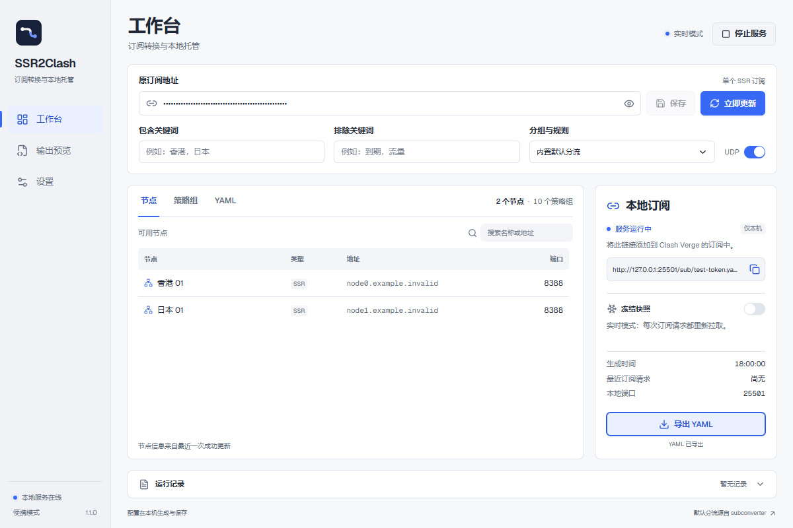

# SSR2Clash

单个 SSR 订阅的转换与本地托管工具。生成包含节点、策略组和规则的完整 Clash 配置，供 Clash Verge 等客户端订阅。



## 使用

1. 填写原始 SSR 订阅地址，点击「立即更新」，查看节点与策略组。
2. 点击「启动服务」，复制右侧本地订阅链接，在 Clash Verge 中添加订阅。
3. 实时模式下，客户端每次 GET 请求都会重新拉取原订阅。开启「冻结快照」后，只返回保存的 YAML，重开应用也会保留快照。
4. 需要独立文件时，直接「导出 YAML」，不必启动服务。默认文件名使用导出时的本地日期，例如 `2026-10-17.yaml`。

关闭窗口默认隐藏到托盘，后台服务继续运行；完全结束应用请使用托盘的「退出」。设置中可开启登录 Windows 后自启，也可关闭「关闭窗口留在托盘」。手动停止服务会记住关闭状态；正常退出后，下次打开会恢复之前的服务开启意图。

## Windows 两种版本

| 版本 | 使用方式 | 配置与快照 |
| --- | --- | --- |
| 便携 ZIP | 完整解压，运行 `ssr2clash.exe`，保留 `portable.flag` | exe 旁的 `data/` |
| 安装版 Setup.exe | 安装向导可选择路径，包括其他盘符和中文、空格目录 | 当前用户应用数据目录，具体位置在设置中查看 |

便携版移动时携带整个文件夹；覆盖升级保留原 `data/`。便携目录移动后，可在设置中重新开启自启。安装版升级沿用已安装目录，卸载默认保留数据，只有明确勾选清理时才删除应用数据。

两种版本使用独立数据目录，同一时间只运行一个 SSR2Clash。切换版本前先从托盘退出。只有保留同一份数据，原本地订阅链接才会延续。安装版不会覆盖一个带有 `portable.flag` 的便携目录。

目标系统为 Windows 10/11 x64。应用需要 Microsoft Edge WebView2；安装版在缺少 Runtime 时会引导下载。

## 分组与规则

- 默认使用内置分流，对照官方 subconverter v0.9.0 的实际输出验证了 10 个策略组及 9797 条规则的顺序。
- 设置中可选择本地或远程 INI 预设，支持常用 `custom_proxy_group`、`ruleset`、`!!import`、相对导入和普通 YAML 基础配置。
- 支持手动选择、自动测速、故障转移、负载均衡，以及常见 Surge、QuanX、Clash 规则列表。
- 脚本、模板语言和未知生效选项会明确报错，不会静默忽略。

内置预设离线可用；实时模式仍会重新获取原订阅。自定义远程预设和规则在实时更新时获取，冻结快照请求不联网。内置预设的来源、样本与再生成脚本在 [测试样本目录](src-tauri/tests/fixtures/subconverter) 中。

合并基础配置与生成规则时，普通规则保留顺序，末尾只保留一条 `MATCH`。两者的最终策略不同会报错，可统一策略或在预设中开启 `overwrite_original_rules`。预设最多 512 组、8192 个选择条件、25 万次成员引用、10 万条规则；超过限制会明确失败，并保留之前成功的结果。

## 本地服务行为

默认仅监听 `127.0.0.1`，端口 `25501`。停止服务后，在「设置 → 本地服务」中开启「允许局域网访问」并保存，再启动服务。右侧同一个订阅地址会切换为自动选择的局域网 IP，网络变化后可点击刷新图标。Windows 优先选择带默认路由的物理网卡，再按路由代价选择；Hyper-V/WSL 内部虚拟网卡不会作为普通候选显示。手机与电脑需要连接同一局域网，电脑和应用保持运行。链接包含随机且持久化的令牌。

端口和局域网开关均在停止服务后修改。程序不会自动修改 Windows 防火墙；手机访问受阻时，可在 Windows 提示中允许专用网络访问。局域网访问同样支持实时更新和冻结快照。

复制链接成功时图标变为对勾，2 秒后恢复。YAML 预览名称与导出共用本地日期命名规则。设置中的数据目录可点击打开文件管理器。

节点列表展示混淆方式（`obfs`）。运行记录移至侧栏的「日志」页面，包含时间、级别和内容。

每次实时 GET 单独刷新，不设 TTL 或请求合并。最多两个转换同时执行；超限返回 503 和 `Retry-After: 1`。HEAD 和 `/health` 不拉取原订阅。更新失败时，仅回退当前配置最近成功的结果，并返回 `X-SSR2Clash-Stale: true`；没有可用结果时返回 502。更改原订阅或输出设置后，旧版本的结果不再作为回退。

## 开发与构建

需要 Node.js 24、Corepack、Rust/MSVC、Windows C++ 构建工具和 WebView2。打包脚本使用 PowerShell 7。pnpm 固定为 `10.34.7`，以仓库 `packageManager` 和 lockfile 为准。

```powershell
corepack pnpm install --frozen-lockfile
corepack pnpm tauri dev
```

生成两个 Windows 版本：

```powershell
corepack pnpm package:windows
```

产物位于 `src-tauri/target/distribution/`，包含便携 ZIP、安装版 EXE、`SHA256SUMS.txt` 与构建来源记录。脚本只构建，不会打开应用或执行安装。

常用检查：

```powershell
corepack pnpm test
corepack pnpm build
corepack pnpm lint
cargo fmt --manifest-path src-tauri/Cargo.toml --check
cargo test --manifest-path src-tauri/Cargo.toml --locked
cargo check --manifest-path src-tauri/Cargo.toml --locked
```

`scripts/` 仅保留 Windows 打包和第三方许可证收集脚本。界面、原生生命周期及安装流程由手动验收完成；CI 保留前端行为测试、lint、Rust 检查和两个版本的构建。

Windows 安装器源码及维护方式见 [安装器说明](src-tauri/installer/README.md)。CI 为分支和 PR 检查、构建并归档两个产物；标签发布先校验版本及 main 归属，两个产物上传草稿成功后再公开 Release。

## 第三方声明

默认分流来自 [tindy2013/subconverter](https://github.com/tindy2013/subconverter)，对应 GPL-3.0 文本随包提供。Tauri、字体和前端依赖的声明见 [THIRD-PARTY-NOTICES.txt](src-tauri/resources/THIRD-PARTY-NOTICES.txt) 与随包的 `licenses/`。
